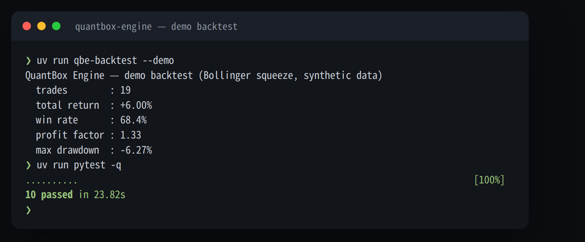
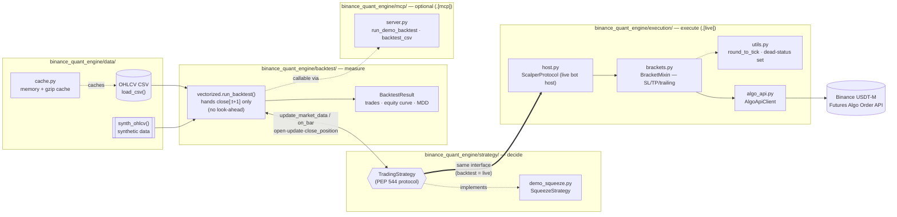

# Binance Quant Engine ⚙️

[](https://github.com/younghwan91/binance-quant-engine/actions/workflows/ci.yml)
[](https://pypi.org/project/binance-quant-engine/)
[](https://www.python.org/downloads/)
[](LICENSE)
[](https://www.linkedin.com/in/younghwan-chae/)

**A strategy-agnostic Binance USDT-M futures backtest & execution engine.** Backtest and live trading run through the *same* strategy code, so a look-ahead bug can't exist in one and not the other — and an [MCP server](#mcp-server-let-an-agent-run-your-backtests) lets any MCP-compatible agent run backtests without writing a line of Python.

Extracted from the infra layer of a real, currently-running Binance USDT-M futures bot — the alpha (strategy, parameters, live P&L) stays private; what's public is the part every retail algo trader rebuilds badly at least once: a backtester that can't cheat, and an execution layer that survives Binance's actual API quirks. The bundled demo strategy is textbook logic (Bollinger squeeze); it exists to exercise the engine end to end, not to make you money.

> This repository supersedes `quantbox-engine`, which is no longer maintained. If you have that repo cloned, switch to this one.

## Why not just write your own backtest loop?

Because the failure modes here are the ones that quietly wreck a real account, not the ones a unit test catches:

| Problem | What usually happens | What this engine does |
|---|---|---|
| Look-ahead bias | A signal computed over a full array accidentally sees future bars | The backtester physically hands the strategy only `close[: t + 1]` each step — there is no future in the array to peek at ([enforced by test](tests/test_backtest.py)) |
| Backtest/live divergence | Backtest logic gets "ported" to the live bot and drifts | One `TradingStrategy` object, same method calls, same order, in both paths |
| Binance tick-size rejection | A price a float-division away from the tick grid gets silently rejected or mispriced | [`round_to_tick`](src/binance_quant_engine/execution/utils.py) snaps every stop/limit/activation price to the symbol's grid before it leaves the process |
| Dead-man's switch | Bot crashes → open position has no stop-loss | SL/TP/trailing stops are placed **on Binance's Algo Order API**, so the exchange — not your process — enforces the exit |

## Quick start

```bash
pip install binance-quant-engine
# or: uv add binance-quant-engine

bqe-backtest --demo      # backtest the bundled demo strategy on synthetic data
```



> ⚠️ The numbers above are from a **demo strategy on synthetic data**. They prove the engine runs; they say nothing about profitability.

## Backtest your own data

```python
from binance_quant_engine.backtest.vectorized import run_backtest
from binance_quant_engine.data.klines import load_csv
from binance_quant_engine.strategy.demo_squeeze import SqueezeStrategy

high, low, close = load_csv("BTCUSDT_1h.csv")   # columns: high,low,close
result = run_backtest(SqueezeStrategy(), high, low, close, fee=0.0004, slippage=0.0002)
print(result.summary())
# {'n_trades': ..., 'total_return': ..., 'win_rate': ..., 'profit_factor': ..., 'max_drawdown': ...}
```

Bring your own strategy by implementing [`TradingStrategy`](src/binance_quant_engine/strategy/protocol.py) — a `typing.Protocol`, no base class required.

### Custom strategy example

Implementing the protocol requires no inheritance (PEP 544 structural subtyping). The engine runs the exact same methods in backtest and live modes:

```python
import numpy as np
from binance_quant_engine.backtest.vectorized import run_backtest
from binance_quant_engine.data.klines import load_csv

class SimpleMomentumStrategy:
    """10-bar momentum with 2% hard stop-loss."""
    def __init__(self, lookback: int = 10, stop_loss: float = 0.02):
        self.lookback = lookback
        self.stop_loss = stop_loss
        self._positions: dict[str, dict] = {}
        self._close: dict[str, np.ndarray] = {}

    @property
    def active_positions(self) -> dict[str, dict]:
        return {k: dict(v) for k, v in self._positions.items()}

    def has_position(self, symbol: str) -> bool:
        return symbol in self._positions

    def update_market_data(self, symbol: str, high: np.ndarray, low: np.ndarray, close: np.ndarray) -> None:
        self._close[symbol] = close  # engine passes completed bars close[:t+1] only

    def on_bar(self, symbol: str, close: np.ndarray) -> int:
        c = self._close.get(symbol, close)
        if len(c) < self.lookback + 1:
            return 0
        return 1 if c[-1] > c[-self.lookback] else -1  # 1=long, -1=short, 0=flat

    def get_last_atr_pct(self, symbol: str) -> float:
        return 0.01  # volatility proxy for position sizing

    def open_position(self, symbol: str, signal: int, entry_price: float, atr_pct: float) -> None:
        self._positions[symbol] = {"signal": signal, "entry_price": entry_price}

    def update_position(self, symbol: str, price: float, high: float | None = None, low: float | None = None) -> str | None:
        pos = self._positions.get(symbol)
        if not pos:
            return None
        pnl = (price - pos["entry_price"]) / pos["entry_price"] if pos["signal"] == 1 else (pos["entry_price"] - price) / pos["entry_price"]
        return "stop_loss" if pnl <= -self.stop_loss else None

    def close_position(self, symbol: str) -> dict | None:
        return self._positions.pop(symbol, None)

# Run backtest with identical interface as live execution
high, low, close = load_csv("BTCUSDT_1h.csv")
result = run_backtest(SimpleMomentumStrategy(), high, low, close, fee=0.0004, slippage=0.0002)
print(result.summary())
```

For live execution wiring and bracket algo order setups: [docs/USAGE.md](docs/USAGE.md).

## MCP server — let an agent run your backtests

```bash
pip install "binance-quant-engine[mcp]"
binance-quant-engine-mcp   # stdio MCP server
```

Exposes `run_demo_backtest`, `backtest_csv`, and `describe_strategy_protocol` to any MCP client (Claude Code, Claude Desktop, etc.) — point an agent at a CSV of OHLC data and it can backtest a strategy idea in the same turn, no local Python environment required on the agent's side.

**This is deliberately backtest-only.** Nothing under `execution/` (order placement, cancellation, bracket management) is reachable through the MCP server — there is no tool call that can touch a live Binance order. If you want an agent that also *trades*, that's a decision you wire yourself, explicitly, outside this server.

## Design

| Design choice | How |
|---|---|
| **No-look-ahead by construction** | The backtester hands the strategy `close[:t+1]` (bars completed as of now) every step — there's no future in the array to see. |
| **Backtest = live, same code** | The same `TradingStrategy` object is driven by the backtester and the live bot, in the same call order. No reimplementation gap. |
| **Pluggable strategy** | The engine only ever talks to a strategy through [`TradingStrategy`](src/binance_quant_engine/strategy/protocol.py) (PEP 544). No inheritance required. |
| **Costs are net, not gross** | Taker fee + slippage charged on both entry and exit legs. |
| **Server-side exits** | SL/TP/trailing stops live on Binance's Algo Order API — the exchange enforces them even if your process dies. ([brackets.py](src/binance_quant_engine/execution/brackets.py)) |
| **Tick-safe prices** | Every price sent to the exchange is snapped to the symbol's tick grid first ([utils.py](src/binance_quant_engine/execution/utils.py)) — a category of Binance rejection this engine doesn't have. |

## Structure

**Decide** (strategy) / **measure** (backtest) / **execute** (live) are kept apart and meet only at `TradingStrategy`.



- How to plug in a strategy and wire up live execution → [docs/USAGE.md](docs/USAGE.md)
- Design rationale for no-look-ahead, backtest/live parity, and the cost model → [docs/ARCHITECTURE.md](docs/ARCHITECTURE.md)

## Contributing & Issues

- 🐛 Bugs & questions → [Issues](https://github.com/younghwan91/binance-quant-engine/issues)
- 🔧 PRs and contributions welcome!
- 📈 Updates → [Follow @younghwan91](https://github.com/younghwan91)


## Related projects — open-source quant stack

Part of an open-source stack spanning Korean equities, US equities and crypto. Each repository stands on its own.

| Market | Project | What it is |
|---|---|---|
| ₿ Crypto | **[crypto-quant-insights](https://github.com/younghwan91/crypto-quant-insights)** | Chart-backed research notes from validating a live Binance futures system — crash stress tests, win rate vs R:R, Kelly leverage, live/backtest execution gaps |
| 🇰🇷 Korean equities | **[kiwoom-client](https://github.com/younghwan91/kiwoom-client)** | Kiwoom Securities REST API client — full domestic-equity endpoint coverage, real-time WebSocket, sync + async (`pip install kiwoom-client`) |
| 🇰🇷 Korean equities | **[krx-fundamentals-client](https://github.com/younghwan91/krx-fundamentals-client)** | Korean corporate fundamentals Python client library — financial statements, valuation, dividends, screening (DART + KRX + Naver) |
| 🇰🇷 Korean equities | **[krx-news-client](https://github.com/younghwan91/krx-news-client)** | Korean market news & disclosure Python client library (DART + Hankyung + TheBell + Toss) |
| 🇰🇷 Korean equities | **[krx-quant-core](https://github.com/younghwan91/krx-quant-core)** | Shared Python core for Korean-equity quant systems — KRX tick, price-limit and session rules, date-aware transaction-tax cost model, Kiwoom order guards, DART material-disclosure risk classification, fill simulation, Deflated Sharpe and purged CV stats |
| 🇰🇷 Korean equities | **[fin-checkup](https://github.com/younghwan91/fin-checkup)** | Telegram alerts for risk disclosures + a DART/SEC financial health checkup — reports measurements and facts, never a recommendation |
| 🇰🇷 Korean equities | **[quant-airflow](https://github.com/younghwan91/quant-airflow)** | Airflow pipeline collecting Korean market data into TimescaleDB — delisted names included, so downstream backtests aren't survivorship-biased |
| 🇰🇷 Korean equities | **[swing-it](https://github.com/younghwan91/swing-it)** | KOSPI/KOSDAQ alpha validation framework — judged on the per-trade distribution, with random null controls, purged CV and Deflated Sharpe enforced as CI guardrails |
| 🇺🇸 US equities | **[portfolio-research](https://github.com/younghwan91/portfolio-research)** | US equity factor engine — walk-forward gated by Deflated Sharpe and PBO on point-in-time, survivorship-bias-free data (plus tactical ETF allocation: 9 pre-registered, 0 adopted) |
| 🇺🇸 US equities | **[macro-sector-agent](https://github.com/younghwan91/macro-sector-agent)** | Top-down US sector-cycle research — asks which industry has been forgotten, not what to buy; machine excludes, never picks |
| 🇺🇸 US equities | **[automated-stock-trading-systems](https://github.com/younghwan91/automated-stock-trading-systems)** | Backtester for Bensdorp's seven non-correlated trading systems (educational reimplementation) |

## Author

**Younghwan Chae** · [GitHub @younghwan91](https://github.com/younghwan91) · [LinkedIn](https://www.linkedin.com/in/younghwan-chae/)

See the full open-source quant stack on my [profile](https://github.com/younghwan91).
