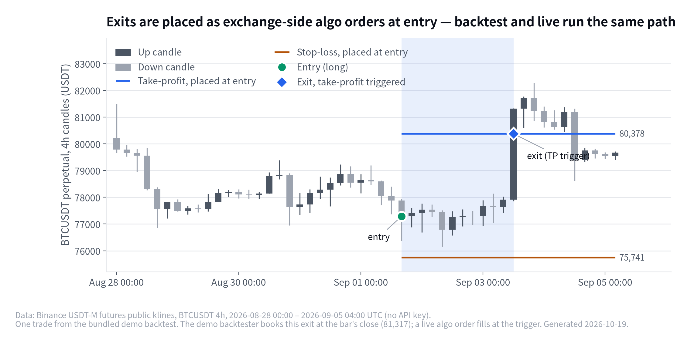

# Binance Quant Engine ⚙️

**Strategy-agnostic Binance USDT-M futures engine — zero look-ahead, backtest and live run the same code path, exits placed as exchange-side algo orders at entry. Optional MCP server.**

[](https://github.com/younghwan91/binance-quant-engine/actions/workflows/ci.yml)
[](https://pypi.org/project/binance-quant-engine/)
[](https://www.python.org/downloads/)
[](LICENSE)
[](https://www.linkedin.com/in/younghwan-chae/)

<picture>
  <source media="(prefers-color-scheme: dark)" srcset="docs/images/hero-dark.png">
  
</picture>

- **The exchange holds your exits.** Stop-loss, take-profit and trailing stop go to Binance's Algo Order API the moment a position opens — if your process dies, the trade still closes. ([brackets.py](src/binance_quant_engine/execution/brackets.py))
- **One strategy object, one call order.** The backtester drives a `TradingStrategy` exactly as the live bot it was extracted from does — same methods, same order — so a bug can't exist in one path and not the other. This repo ships the backtester, the protocol and the execution mixins; the live driver stays private.
- **No future in the array.** At bar `t` the strategy is handed `close[:t+1]` and nothing else — [enforced by a test](tests/test_backtest.py).

This is the engine, not the alpha. It was extracted from the infrastructure of a private, running futures bot; strategies, parameters, live results and the live driver itself stay there. The bundled Bollinger-squeeze demo only exists to exercise the engine end to end.

## Quick start

```bash
pip install binance-quant-engine      # or: uv add binance-quant-engine
bqe-backtest --demo                   # demo strategy on synthetic data, no keys, no network
```

```text
Binance Quant Engine — demo backtest (Bollinger squeeze, synthetic data)
  trades        : 19
  total return  : +6.00%
  win rate      : 68.4%
  profit factor : 1.33
  max drawdown  : -6.27%
```

⚠️ Synthetic data, textbook demo strategy: this proves the engine runs and says nothing about profitability.

```python
from binance_quant_engine.backtest.vectorized import run_backtest
from binance_quant_engine.data.klines import load_csv
from binance_quant_engine.strategy.demo_squeeze import SqueezeStrategy

high, low, close = load_csv("BTCUSDT_1h.csv")   # columns: high,low,close
result = run_backtest(SqueezeStrategy(), high, low, close, fee=0.0004, slippage=0.0002)
print(result.summary())
# {'n_trades': ..., 'total_return': ..., 'win_rate': ..., 'profit_factor': ..., 'max_drawdown': ...}
```

## What it does

- **Backtest** — `run_backtest()` steps a strategy bar by bar over one OHLC series and returns trades, equity curve and max drawdown. Taker fee and slippage are charged on both legs; every number is net.
- **Strategy interface** — [`TradingStrategy`](src/binance_quant_engine/strategy/protocol.py) is a `typing.Protocol` (PEP 544): implement the methods, no base class.
- **Live execution** (`.[live]`) — a `BracketMixin` that places SL / TP / `TRAILING_STOP_MARKET` as Binance algo orders at entry, ratchets the stop-loss order upward (place-new-then-cancel-old), lets Binance trail the `TRAILING_STOP_MARKET`, verifies brackets are still alive and recognises the terminal statuses, `REJECTED` included.
- **Data** — `load_csv()` for your own klines, `synth_ohlcv()` for a deterministic series with alternating volatility regimes, a memory + gzip cache.

## Why it is built this way

| Failure mode | What usually happens | What this engine does |
|---|---|---|
| Look-ahead bias | A signal computed over the full array quietly sees future bars | The backtester hands the strategy only `close[:t+1]` each step; a test asserts the strategy never sees past `t` |
| Backtest / live divergence | Backtest logic is "ported" to the bot and drifts | One `TradingStrategy` object, same calls, same order — the live bot it was extracted from drives it exactly as the backtester does |
| Bot crashes with a position open | No stop-loss, until you notice | Exits live on Binance's Algo Order API, so the exchange enforces them |
| Tick-size rejection | A price one float division off the grid is rejected or mispriced | [`round_to_tick`](src/binance_quant_engine/execution/utils.py) snaps every outgoing stop, limit and activation price to the symbol's grid |
| Agent with a live key | An LLM tool call places a real order | The MCP server is backtest-only by construction; trading is something you wire yourself, explicitly |

## Bring your own strategy

Implement the protocol, no inheritance. The backtester runs exactly these methods, and the live bot it was extracted from runs the same ones. Signals are `-1` short, `0` flat, `+1` long.

<details>
<summary>Self-contained example: 10-bar momentum with a 2 % hard stop</summary>

```python
import numpy as np
from binance_quant_engine.backtest.vectorized import run_backtest
from binance_quant_engine.data.klines import load_csv

class SimpleMomentumStrategy:
    """10-bar momentum with 2% hard stop-loss."""
    def __init__(self, lookback: int = 10, stop_loss: float = 0.02):
        self.lookback = lookback
        self.stop_loss = stop_loss
        self._positions: dict[str, dict] = {}
        self._close: dict[str, np.ndarray] = {}

    @property
    def active_positions(self) -> dict[str, dict]:
        return {k: dict(v) for k, v in self._positions.items()}

    def has_position(self, symbol: str) -> bool:
        return symbol in self._positions

    def update_market_data(self, symbol: str, high: np.ndarray, low: np.ndarray, close: np.ndarray) -> None:
        self._close[symbol] = close  # engine passes completed bars close[:t+1] only

    def on_bar(self, symbol: str, close: np.ndarray) -> int:
        c = self._close.get(symbol, close)
        if len(c) < self.lookback + 1:
            return 0
        return 1 if c[-1] > c[-self.lookback] else -1  # 1=long, -1=short, 0=flat

    def get_last_atr_pct(self, symbol: str) -> float:
        return 0.01  # volatility proxy for position sizing

    def open_position(self, symbol: str, signal: int, entry_price: float, atr_pct: float) -> None:
        self._positions[symbol] = {"signal": signal, "entry_price": entry_price}

    def update_position(self, symbol: str, price: float, high: float | None = None, low: float | None = None) -> str | None:
        pos = self._positions.get(symbol)
        if not pos:
            return None
        pnl = (price - pos["entry_price"]) / pos["entry_price"] if pos["signal"] == 1 else (pos["entry_price"] - price) / pos["entry_price"]
        return "stop_loss" if pnl <= -self.stop_loss else None

    def close_position(self, symbol: str) -> dict | None:
        return self._positions.pop(symbol, None)

# Run backtest with identical interface as live execution
high, low, close = load_csv("BTCUSDT_1h.csv")
result = run_backtest(SimpleMomentumStrategy(), high, low, close, fee=0.0004, slippage=0.0002)
print(result.summary())
```

</details>

## MCP server — let an agent run your backtests

```bash
pip install "binance-quant-engine[mcp]"
binance-quant-engine-mcp   # stdio MCP server
```

Exposes `run_demo_backtest`, `backtest_csv` and `describe_strategy_protocol` to any MCP client (Claude Code, Claude Desktop, …): hand an agent a CSV of OHLC data and it can backtest an idea in the same turn. There is no tool that can touch a live order.

## Structure

**Decide** (strategy) / **measure** (backtest) / **execute** (live) are kept apart and meet only at `TradingStrategy`.


- Plug in a strategy, wire up live execution → [docs/USAGE.md](docs/USAGE.md)
- No-look-ahead, backtest/live parity, execution layer, cost model → [docs/ARCHITECTURE.md](docs/ARCHITECTURE.md)

## Install, configure, develop

```bash
pip install binance-quant-engine            # backtests only: numpy + pandas
pip install "binance-quant-engine[live]"    # + python-binance; cp .env.example .env (API key, secret, testnet flag; .env is gitignored)
pip install "binance-quant-engine[mcp]"     # + mcp
uv pip install -e ".[dev]" && uv run pytest -q && uv run ruff check .   # contributing; tests need no network or key
```

## Contributing & Issues

- 🐛 Bugs & questions → [Issues](https://github.com/younghwan91/binance-quant-engine/issues)
- 🔧 PRs and contributions welcome!
- 📈 Updates → [Follow @younghwan91](https://github.com/younghwan91)

## Related projects — open-source quant stack

Part of an open-source stack spanning Korean equities, US equities and crypto. Each repository stands on its own.

| Market | Project | What it is |
|---|---|---|
| 🇰🇷 Korean equities | **[kiwoom-client](https://github.com/younghwan91/kiwoom-client)** | Kiwoom Securities REST API client — full domestic-equity endpoint coverage, real-time WebSocket, sync + async (`pip install kiwoom-client`) |
| 🇰🇷 Korean equities | **[krx-fundamentals-client](https://github.com/younghwan91/krx-fundamentals-client)** | Korean corporate fundamentals Python client library — financial statements, valuation, dividends, screening (DART + KRX + Naver) |
| 🇰🇷 Korean equities | **[krx-news-client](https://github.com/younghwan91/krx-news-client)** | Korean market news & disclosures as one schema — Python client library (DART + Toss Securities) |
| 🇰🇷 Korean equities | **[krx-quant-core](https://github.com/younghwan91/krx-quant-core)** | Shared Python core for Korean-equity quant systems — KRX tick, price-limit and session rules, date-aware transaction-tax cost model, Kiwoom order guards, DART material-disclosure risk classification, fill simulation, Deflated Sharpe and purged CV stats |
| 🇰🇷 Korean equities | **[fin-checkup](https://github.com/younghwan91/fin-checkup)** | Telegram alerts for risk disclosures + a DART/SEC financial health checkup — reports measurements and facts, never a recommendation |
| 🇰🇷 Korean equities | **[quant-airflow](https://github.com/younghwan91/quant-airflow)** | Airflow pipeline collecting Korean market data into TimescaleDB — delisted names included, so downstream backtests aren't survivorship-biased |
| 🇰🇷 Korean equities | **[swing-it](https://github.com/younghwan91/swing-it)** | KOSPI/KOSDAQ alpha validation framework — judged on the per-trade distribution, with random null controls, purged CV and Deflated Sharpe enforced as CI guardrails |
| 🇺🇸 US equities | **[portfolio-research](https://github.com/younghwan91/portfolio-research)** | US equity factor engine — walk-forward gated by Deflated Sharpe and PBO on point-in-time, survivorship-bias-free data; tactical ETF allocation goes through the same gate |
| 🇺🇸 US equities | **[macro-sector-agent](https://github.com/younghwan91/macro-sector-agent)** | Top-down US sector-cycle research — asks which industry has been forgotten, not what to buy; the machine excludes, never picks |
| 🇺🇸 US equities | **[automated-stock-trading-systems](https://github.com/younghwan91/automated-stock-trading-systems)** | Backtester for Bensdorp's seven non-correlated trading systems (educational reimplementation) |
| ₿ Crypto | **[crypto-quant-insights](https://github.com/younghwan91/crypto-quant-insights)** | Chart-backed research notes from validating a live futures system — crash stress tests, Kelly leverage, live/backtest execution gaps |

## Author

**Younghwan Chae** · [GitHub @younghwan91](https://github.com/younghwan91) · [LinkedIn](https://www.linkedin.com/in/younghwan-chae/)

See the full open-source quant stack on my [profile](https://github.com/younghwan91).
